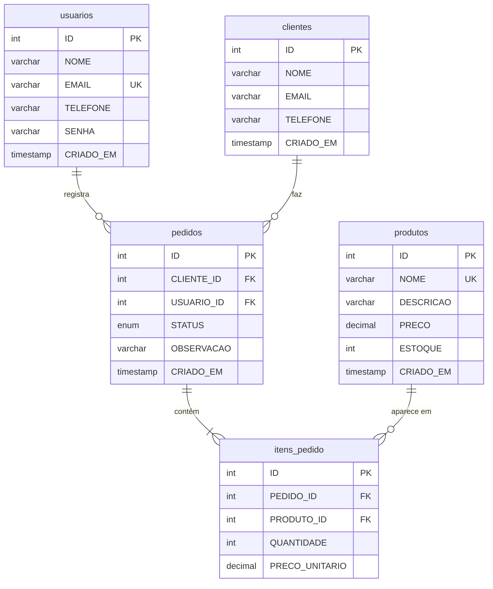

# 📘 Documentação Técnica — Mini Sistema de Gerenciamento de Clientes

> Documentação completa do projeto: arquitetura, banco de dados, fluxo de cada página,
> front-end, segurança, níveis de acesso, problemas conhecidos e um guia de consultas SQL
> (do básico ao avançado).

---

## Sumário

1. [Visão geral](#1-visão-geral)
2. [Tecnologias](#2-tecnologias)
3. [Instalação e execução](#3-instalação-e-execução)
4. [Estrutura de arquivos](#4-estrutura-de-arquivos)
5. [Arquitetura e fluxo de requisições](#5-arquitetura-e-fluxo-de-requisições)
6. [Banco de dados](#6-banco-de-dados)
7. [Descrição de cada arquivo](#7-descrição-de-cada-arquivo)
8. [Front-end (CSS e JavaScript)](#8-front-end-css-e-javascript)
9. [Segurança](#9-segurança)
10. [Problemas conhecidos e melhorias sugeridas](#10-problemas-conhecidos-e-melhorias-sugeridas)
11. [Guia de consultas SQL](#11-guia-de-consultas-sql)

---

## 1. Visão geral

O **Mini Sistema** é uma aplicação web de gestão de clientes, produtos e pedidos, escrita em PHP
puro (sem framework), com banco MySQL/MariaDB acessado via **PDO**. Todo o sistema fica protegido
por uma tela de **login** baseada em sessão PHP, com dois níveis de acesso (**Administrador** e
**Operador**).

| Funcionalidade | Página          | Operação SQL principal |
|----------------|-----------------|------------------------|
| Login / Logout | `login.php`, `logout.php` | `SELECT` + limite de tentativas (`tentativas_login`) |
| Painel (início) | `index.php`    | `SELECT` com subconsultas (totais, últimos pedidos, estoque baixo) |
| Relatórios     | `relatorios.php`, `relatorio_exportar.php` | Agrupamentos por mês/dia, status, produto e cliente; exportação CSV |
| Clientes: listar/buscar | `clientes.php` | `SELECT` + `LEFT JOIN vw_pedidos`, busca, ordenação e paginação |
| Clientes: cadastrar/editar | `cadastro.php`, `atualizar.php` | `INSERT` / `UPDATE` (documento, endereço e observações) |
| Clientes: ficha | `cliente_ver.php` | Indicadores, histórico de pedidos e produtos mais comprados |
| Clientes: importar | `cliente_importar.php` | `INSERT` em lote a partir de uma planilha CSV |
| Clientes: apagar | `apagar.php` | `DELETE` (recusado se o cliente tiver pedidos) |
| Produtos       | `produtos.php`, `produto_cadastro.php`, `produto_apagar.php` | `SELECT` / `INSERT` / `UPDATE` / `DELETE` |
| Estoque        | `produto_estoque.php` | Entradas, saídas e ajustes com histórico (`movimentos_estoque`) |
| Pedidos        | `pedidos.php`   | `SELECT` em `vw_pedidos` com filtros e paginação |
| Novo/editar pedido | `pedido_novo.php` | `INSERT`/`UPDATE` em `pedidos` e `itens_pedido` (transação) |
| Ver pedido / status | `pedido_ver.php` | `SELECT` com `JOIN` + `UPDATE` |
| Imprimir pedido | `pedido_imprimir.php` | Comprovante para imprimir ou salvar em PDF |
| Apagar pedido  | `pedido_apagar.php` | `DELETE` (itens apagados por `CASCADE`) |
| Usuários       | `usuarios.php`, `usuario_cadastro.php`, `usuario_apagar.php` | Somente administradores |
| Meu perfil     | `perfil.php`    | `UPDATE` dos próprios dados e da senha |
| Atividades     | `atividades.php` | Registro de quem fez o quê (somente administradores) |
| Relacionamentos | `relacionamentos.php` | Diagrama + `SELECT` com `JOIN` nas 5 tabelas principais |

O banco tem **5 tabelas principais relacionadas** (`usuarios`, `clientes`, `produtos`, `pedidos` e
`itens_pedido`), mais **3 tabelas de apoio** (`movimentos_estoque`, `atividades` e
`tentativas_login`) e a visão `vw_pedidos` (detalhes na [seção 6](#6-banco-de-dados)).

### 1.1 Níveis de acesso

| Ação | Administrador | Operador |
|------|:---:|:---:|
| Ver painel, relatórios, listas e fichas | ✅ | ✅ |
| Cadastrar e editar clientes, produtos e pedidos | ✅ | ✅ |
| Importar clientes, movimentar estoque | ✅ | ✅ |
| Apagar clientes, produtos e pedidos | ✅ | ❌ |
| Gerenciar usuários | ✅ | ❌ |
| Ver o registro de atividades | ✅ | ❌ |

O sistema nunca fica sem administrador: o último não pode ser apagado nem rebaixado, e ninguém
apaga o próprio usuário.

---

## 2. Tecnologias

| Camada         | Tecnologia                                         |
|----------------|----------------------------------------------------|
| Servidor       | Apache (XAMPP) ou servidor embutido do PHP         |
| Back-end       | PHP 8.0+ (`match`, *spread* em arrays, `declare(strict_types=1)` em parte dos arquivos) |
| Banco de dados | MariaDB 10.2+ / MySQL (o XAMPP traz MariaDB)       |
| Acesso a dados | PDO com *prepared statements*                      |
| Front-end      | HTML5, CSS3 (variáveis CSS, layout responsivo, modo escuro), JavaScript puro |
| Serviço externo | [ViaCEP](https://viacep.com.br) (opcional, para preencher o endereço pelo CEP) |

---

## 3. Instalação e execução

### 3.1 Pré-requisitos
- XAMPP instalado, com **Apache** e **MySQL** iniciados no painel de controle.
- Projeto dentro de `C:\xampp\htdocs\mini_sistema\mini_sistema`.

### 3.2 Criar o banco e as tabelas

No phpMyAdmin (`http://localhost/phpmyadmin`) ou no terminal do MySQL:

```sql
CREATE DATABASE IF NOT EXISTS mini_sistema
  CHARACTER SET utf8mb4
  COLLATE utf8mb4_unicode_ci;

USE mini_sistema;
```

Depois, execute os quatro scripts do projeto, **nesta ordem** (cada um depende dos anteriores):
- [usuarios.sql](usuarios.sql) — cria a tabela `usuarios` (login) e o usuário administrador;
- [clientes.sql](clientes.sql) — cria a tabela `clientes`;
- [relacionamentos.sql](relacionamentos.sql) — cria `produtos`, `pedidos` e `itens_pedido` com as
  chaves estrangeiras, e insere dados de exemplo (5 produtos, 2 clientes e 2 pedidos);
- [melhorias.sql](melhorias.sql) — níveis de acesso, documento/endereço dos clientes, desconto e
  forma de pagamento nos pedidos, a visão `vw_pedidos` e as tabelas `movimentos_estoque`,
  `atividades` e `tentativas_login`.

Pelo terminal:

```bash
C:\xampp\mysql\bin\mysql.exe -u root mini_sistema < usuarios.sql
C:\xampp\mysql\bin\mysql.exe -u root mini_sistema < clientes.sql
C:\xampp\mysql\bin\mysql.exe -u root mini_sistema < relacionamentos.sql
C:\xampp\mysql\bin\mysql.exe -u root mini_sistema < melhorias.sql
```

Todos os scripts podem ser executados mais de uma vez sem duplicar tabelas nem dados. Em um banco
que já estava em uso, basta rodar o `melhorias.sql`: ele só **acrescenta** colunas e tabelas.

> O `relacionamentos.sql` começa com `SET NAMES utf8mb4`: sem isso, o cliente `mysql` do Windows
> importaria os acentos com outro charset e gravaria "mecânico" no lugar de "mecânico".

### 3.3 Acessar

- Via Apache do XAMPP: `http://localhost/mini_sistema/mini_sistema/login.php`
- Ou via servidor embutido do PHP (na pasta do projeto), acessando depois `http://localhost:8000`:

```bash
php -S localhost:8000
```

**Login inicial:** `admin@sistema.com` / `admin123`. A senha não aparece mais na tela de login; enquanto
ela não for trocada, o painel mostra um aviso com o atalho para **Meu perfil → Alterar senha**.

### 3.4 Configuração da conexão

Os dados de conexão ficam em [conexao.php](conexao.php):

| Variável    | Valor padrão   |
|-------------|----------------|
| `$host`     | `127.0.0.1`    |
| `$dbname`   | `mini_sistema` |
| `$user`     | `root`         |
| `$password` | *(vazio)*      |

---

## 4. Estrutura de arquivos

```
mini_sistema/
├── conexao.php      # Cria o objeto $pdo (conexão com o banco)
├── sessao.php       # Fuso horário, cookie de sessão seguro e session_start()
├── auth.php         # "Guarda" das páginas: exige login, recarrega o perfil e confere o token CSRF
├── seguranca.php    # CSRF, níveis de acesso, limite de tentativas de login e registro de atividades
├── login.php        # Formulário e processamento do login
├── logout.php       # Sai do sistema (somente por POST com token)
├── index.php        # Painel inicial: totais, últimos pedidos e estoque baixo
├── relatorios.php   # Relatórios de vendas com gráfico, filtros de período e comparação
├── relatorios_funcoes.php # Período e consultas dos relatórios
├── relatorio_exportar.php # Exporta pedidos/produtos/clientes do período em CSV
├── cadastro.php     # Cadastro de cliente (INSERT)
├── clientes.php     # Lista de clientes com busca, ordenação e paginação
├── cliente_ver.php  # Ficha do cliente: dados, indicadores, histórico e produtos favoritos
├── cliente_importar.php # Importação de clientes de planilha CSV
├── atualizar.php    # Edição de cliente (SELECT + UPDATE)
├── apagar.php       # Exclusão de cliente (bloqueada se ele tiver pedidos)
├── produto_cadastro.php # Cadastro (com estoque inicial) e edição de produto
├── produtos.php     # Lista de produtos com busca, filtro de estoque e paginação
├── produto_estoque.php # Entradas, saídas, ajustes e histórico de estoque de um produto
├── produto_apagar.php # Exclusão de produto (bloqueada se ele já foi vendido)
├── pedidos.php      # Lista de pedidos com filtros (status, período, cliente) e paginação
├── pedido_novo.php  # Registro e edição de pedido (itens, desconto, pagamento)
├── pedido_ver.php   # Detalhes do pedido e mudança de status
├── pedido_imprimir.php # Comprovante do pedido para imprimir / salvar em PDF
├── pedido_apagar.php # Exclusão de pedido (itens apagados em cascata)
├── usuarios.php     # Lista de usuários (somente administradores)
├── usuario_cadastro.php # Cadastro/edição de usuário, com perfil de acesso
├── usuario_apagar.php # Exclusão de usuário (pedidos registrados são mantidos)
├── perfil.php       # Meu perfil: dados pessoais e troca de senha
├── atividades.php   # Registro de atividades (somente administradores)
├── relacionamentos.php # Diagrama e explicação das 5 tabelas + consulta ao vivo
├── estoque.php      # movimentar_estoque() e as regras de estoque dos pedidos
├── lista.php        # Ordenação, paginação e filtros compartilhados pelas listas
├── header.php       # Menu lateral (agrupado por perfil), tema, usuário logado e breadcrumb
├── footer.php       # Rodapé, toasts e modal de exclusão (POST com token)
├── form_campos.php  # Renderiza campos de formulário (input, select, textarea)
├── form_cliente.php # Campos do cliente em 3 seções (dados, endereço, observações)
├── validacao.php    # Regras de validação: cliente (CPF/CNPJ, CEP, UF), usuário e senha
├── ui.php           # Ícones, formatação (moeda, CPF/CNPJ, CEP, endereço), status e flash()
├── usuarios.sql     # Script da tabela `usuarios` + usuário admin
├── clientes.sql     # Script da tabela `clientes`
├── relacionamentos.sql # Script de `produtos`, `pedidos` e `itens_pedido` + dados de exemplo
├── melhorias.sql    # Colunas e tabelas novas (perfis, endereço, desconto, estoque, atividades)
├── css/
│   └── style.css    # Estilo de todas as páginas, inclusive modo escuro e impressão
├── js/
│   ├── app.js        # Toasts, modal de exclusão, filtros automáticos e modo escuro
│   ├── formulario.js # Validação e máscaras dos formulários de cliente e usuário
│   ├── endereco.js   # Máscaras de CPF/CNPJ e CEP + busca do endereço pelo CEP
│   ├── relatorios.js # Dicas (tooltip) do gráfico de faturamento
│   ├── pedido.js     # Itens, subtotal, desconto e total do formulário de pedido
│   └── moeda.js      # Máscara de reais (preço e desconto)
├── imagens/
│   └── bem-vindo.jpeg
├── README.md        # Resumo do projeto
└── DOCUMENTACAO.md  # Este documento
```

---

## 5. Arquitetura e fluxo de requisições

O projeto segue o modelo **"uma página PHP = uma tela"**: cada arquivo processa o formulário
(quando a requisição é `POST`) no topo e, em seguida, renderiza o HTML.

### 5.1 Cadeia de includes

```
página protegida (ex.: clientes.php)
   ├── require auth.php
   │      ├── require sessao.php     → fuso horário + cookie httponly/samesite + session_start()
   │      ├── require conexao.php    → $pdo pronto para uso
   │      ├── require seguranca.php  → csrf_*, eh_admin(), registrar_atividade()...
   │      ├── sem $_SESSION['usuario_id']?  → login.php?redirect=clientes.php
   │      ├── recarrega NOME/EMAIL/PERFIL do banco (usuário apagado → desconectado)
   │      └── POST sem token CSRF válido?   → recusa e volta para a página
   ├── (opcional) exigir_admin()       → páginas exclusivas de administrador
   ├── include header.php              → menu lateral + breadcrumb + tema salvo
   └── include footer.php              → rodapé, toasts, modal de exclusão e js/app.js
```

> As variáveis internas do `header.php` usam o prefixo `menu` (`$menuLinks`, `$menuHref`...)
> para não sobrescrever variáveis da página que o inclui (ex.: `$itens` em `pedido_ver.php`).

### 5.2 Fluxo de login

```
Usuário acessa clientes.php sem estar logado
        │
        ▼
auth.php → Location: login.php?redirect=clientes.php
        │
        ▼
login.php (POST email + senha + token CSRF)
   ├── token inválido?                    → "A página de login expirou"
   ├── 5 erros em 15 min (email) ou 20 (IP)? → bloqueio temporário, nem confere a senha
   ├── SELECT ID, NOME, EMAIL, SENHA, PERFIL FROM usuarios WHERE EMAIL = ?
   ├── password_verify(senha, hash)
   │     ├── OK   → session_regenerate_id(true), novo token CSRF
   │     │          grava usuario_id / nome / email / perfil na sessão
   │     │          limpa as tentativas erradas, registra "Entrou no sistema"
   │     │          Location: clientes.php   (valor de redirect)
   │     └── Falha → grava a tentativa; avisa quando restam 2 ou menos
```

O parâmetro `redirect` é validado com a regex `^[a-zA-Z0-9_\-]+\.php$`, impedindo
redirecionamento para sites externos (*open redirect*).

### 5.3 Fluxo do CRUD

```
cadastro.php  ──POST──► validar_cliente_completo() ──► INSERT ──► ficha do cliente (toast)
clientes.php  ──GET───► busca (?q=), ordenação (?ordem=&dir=) e paginação (?pagina=&por=)
   ├── 👁 Ficha   → cliente_ver.php?id=N
   ├── ✏️ Editar  → atualizar.php?id=N ──GET──► SELECT por ID
   │                                   ──POST─► UPDATE por ID
   └── Apagar (só admin) → modal → POST apagar.php?id=N (com token)
                                     ├► tem pedidos? → flash(erro), nada é apagado
                                     └► senão DELETE → registra atividade → clientes.php (toast)
```

Todas as exclusões (`apagar.php`, `produto_apagar.php`, `pedido_apagar.php`, `usuario_apagar.php`)
chamam `exigir_post()` e `exigir_admin()`: um link GET (vindo de outro site, por exemplo) é
recusado.

### 5.3.1 Fluxo do pedido

```
pedido_novo.php ──POST──► valida cliente, status, pagamento, desconto e itens
   └── beginTransaction()
         ├── INSERT INTO pedidos (..., DESCONTO, FORMA_PAGAMENTO, USUARIO_ID = usuário logado)
         ├── INSERT INTO itens_pedido ... SELECT preço atual FROM produtos   (1 por produto)
         ├── baixar_estoque() → movimentar_estoque() por item (FOR UPDATE + histórico)
         ├── faltou estoque? → rollBack() (nada é gravado) + mensagem de erro
         └── tudo certo      → commit() → registra atividade → pedido_ver.php?id=N

pedido_novo.php?id=N (só pedidos ABERTOS)
   └── beginTransaction()
         ├── SELECT STATUS ... FOR UPDATE (confere que ainda está aberto)
         ├── UPDATE pedidos; DELETE + INSERT dos itens
         │     (produto que já estava no pedido mantém o preço original)
         └── ajustar_estoque_pedido() → movimenta só a diferença de cada produto
```

### 5.4 Variáveis de sessão

| Chave                         | Conteúdo                         |
|-------------------------------|----------------------------------|
| `$_SESSION['usuario_id']`     | ID do usuário logado             |
| `$_SESSION['usuario_nome']`   | Nome exibido no menu lateral e na saudação do painel |
| `$_SESSION['usuario_email']`  | Email do usuário logado          |
| `$_SESSION['usuario_perfil']` | `ADMIN` ou `OPERADOR` (recarregado do banco a cada página) |
| `$_SESSION['csrf']`           | Token secreto enviado em todo formulário `POST` |
| `$_SESSION['flash']`          | Mensagens que aparecem como toast na próxima página |

---

## 6. Banco de dados

Banco: **`mini_sistema`** (charset `utf8mb4`).

### 6.1 Tabela `usuarios`

Usada para **autenticação**. Criada por [usuarios.sql](usuarios.sql); a coluna `PERFIL` vem do
[melhorias.sql](melhorias.sql).

| Coluna      | Tipo           | Restrições                          | Descrição               |
|-------------|----------------|-------------------------------------|-------------------------|
| `ID`        | `INT(11)`      | PK, `AUTO_INCREMENT`                | Identificador           |
| `NOME`      | `VARCHAR(100)` | `NOT NULL`                          | Nome do usuário         |
| `EMAIL`     | `VARCHAR(100)` | `NOT NULL`, `UNIQUE`                | Login                   |
| `TELEFONE`  | `VARCHAR(20)`  | `NULL`                              | Telefone (opcional)     |
| `SENHA`     | `VARCHAR(255)` | `NOT NULL`                          | Hash bcrypt da senha    |
| `PERFIL`    | `ENUM('ADMIN','OPERADOR')` | `NOT NULL`, padrão `OPERADOR` | Nível de acesso |
| `CRIADO_EM` | `TIMESTAMP`    | `DEFAULT CURRENT_TIMESTAMP`         | Data de criação         |

### 6.2 Tabela `clientes`

Tabela dos **clientes**. Criada por [clientes.sql](clientes.sql); documento, endereço e observações
vêm do [melhorias.sql](melhorias.sql). A coluna `CRIADO_EM` é preenchida automaticamente e é
usada em várias consultas da seção 11.

| Coluna        | Tipo           | Restrições            | Descrição |
|---------------|----------------|-----------------------|-----------|
| `ID`          | `INT(11)`      | PK, `AUTO_INCREMENT`  | Identificador |
| `NOME`        | `VARCHAR(100)` | `NOT NULL`            | Nome ou razão social |
| `EMAIL`       | `VARCHAR(100)` | `NOT NULL`            | Email |
| `TELEFONE`    | `VARCHAR(20)`  | `NULL`                | Telefone formatado |
| `CPF_CNPJ`    | `VARCHAR(14)`  | `NULL`, `UNIQUE`      | Só os dígitos (11 = CPF, 14 = CNPJ), com dígitos verificadores conferidos |
| `CEP`         | `VARCHAR(8)`   | `NULL`                | Só os dígitos |
| `LOGRADOURO`, `NUMERO`, `COMPLEMENTO`, `BAIRRO`, `CIDADE` | `VARCHAR` | `NULL` | Endereço |
| `UF`          | `CHAR(2)`      | `NULL`                | Sigla do estado |
| `OBSERVACOES` | `TEXT`         | `NULL`                | Anotações livres (até 2000 caracteres na tela) |
| `CRIADO_EM`   | `TIMESTAMP`    | `DEFAULT CURRENT_TIMESTAMP` | Data do cadastro |

### 6.3 Tabela `produtos`

Catálogo de produtos que podem ser vendidos. Criada por [relacionamentos.sql](relacionamentos.sql).

| Coluna      | Tipo            | Restrições                         | Descrição                    |
|-------------|-----------------|------------------------------------|------------------------------|
| `ID`        | `INT(11)`       | PK, `AUTO_INCREMENT`               | Identificador                |
| `NOME`      | `VARCHAR(100)`  | `NOT NULL`, `UNIQUE`               | Nome do produto              |
| `DESCRICAO` | `VARCHAR(255)`  | `NULL`                             | Descrição (opcional)         |
| `PRECO`     | `DECIMAL(10,2)` | `NOT NULL`, `CHECK (PRECO >= 0)`   | Preço atual                  |
| `ESTOQUE`   | `INT(11)`       | `NOT NULL`, `DEFAULT 0`, `CHECK (ESTOQUE >= 0)` | Quantidade disponível |
| `CRIADO_EM` | `TIMESTAMP`     | `DEFAULT CURRENT_TIMESTAMP`        | Data de criação              |

### 6.4 Tabela `pedidos`

Cada pedido pertence a **um cliente** e foi registrado por **um usuário** do sistema.

| Coluna       | Tipo           | Restrições                                   | Descrição                         |
|--------------|----------------|----------------------------------------------|-----------------------------------|
| `ID`         | `INT(11)`      | PK, `AUTO_INCREMENT`                         | Número do pedido                  |
| `CLIENTE_ID` | `INT(11)`      | `NOT NULL`, **FK → `clientes.ID`**           | Quem comprou                      |
| `USUARIO_ID` | `INT(11)`      | `NULL`, **FK → `usuarios.ID`**               | Quem registrou (usuário logado)   |
| `STATUS`     | `ENUM`         | `'ABERTO'`, `'PAGO'`, `'ENVIADO'`, `'CANCELADO'` (padrão `ABERTO`) | Situação |
| `OBSERVACAO` | `VARCHAR(255)` | `NULL`                                       | Observação livre                  |
| `DESCONTO`   | `DECIMAL(10,2)`| `NOT NULL`, padrão `0`                       | Desconto em reais (não passa do valor dos itens) |
| `FORMA_PAGAMENTO` | `ENUM`    | `'PIX'`, `'DINHEIRO'`, `'CREDITO'`, `'DEBITO'`, `'BOLETO'` ou `NULL` | Como o cliente pagou |
| `CRIADO_EM`  | `TIMESTAMP`    | `DEFAULT CURRENT_TIMESTAMP`                  | Data do pedido                    |

### 6.5 Tabela `itens_pedido`

Tabela **associativa** que resolve o relacionamento **N:N** entre `pedidos` e `produtos`: cada
linha diz "neste pedido, este produto, nesta quantidade, por este preço".

| Coluna           | Tipo            | Restrições                              | Descrição                                |
|------------------|-----------------|-----------------------------------------|------------------------------------------|
| `ID`             | `INT(11)`       | PK, `AUTO_INCREMENT`                    | Identificador                            |
| `PEDIDO_ID`      | `INT(11)`       | `NOT NULL`, **FK → `pedidos.ID`**       | Pedido ao qual o item pertence           |
| `PRODUTO_ID`     | `INT(11)`       | `NOT NULL`, **FK → `produtos.ID`**      | Produto vendido                          |
| `QUANTIDADE`     | `INT(11)`       | `NOT NULL`, `CHECK (QUANTIDADE > 0)`    | Quantidade                               |
| `PRECO_UNITARIO` | `DECIMAL(10,2)` | `NOT NULL`                              | Preço **no momento da venda** (cópia de `produtos.PRECO`) |

Chave única `(PEDIDO_ID, PRODUTO_ID)`: o mesmo produto não aparece duas vezes no mesmo pedido
(se o usuário escolher o mesmo produto em duas linhas, o sistema soma as quantidades).

> **Por que copiar o preço?** Se o preço do produto mudar amanhã, os pedidos antigos continuam
> com o valor que o cliente realmente pagou.

### 6.6 Relacionamentos

| # | Relacionamento | Tipo | Chave estrangeira | `ON DELETE` | Significado |
|---|----------------|------|-------------------|-------------|-------------|
| 1 | `clientes` → `pedidos` | **1 : N** | `pedidos.CLIENTE_ID` → `clientes.ID` (`FK_PEDIDOS_CLIENTE`) | `RESTRICT` | Um cliente faz vários pedidos; cada pedido é de um único cliente. Cliente com pedidos **não pode ser apagado**. |
| 2 | `usuarios` → `pedidos` | **1 : N** | `pedidos.USUARIO_ID` → `usuarios.ID` (`FK_PEDIDOS_USUARIO`) | `SET NULL` | Um usuário registra vários pedidos. Se o usuário for apagado, o pedido continua, com `USUARIO_ID = NULL`. |
| 3 | `pedidos` → `itens_pedido` | **1 : N** | `itens_pedido.PEDIDO_ID` → `pedidos.ID` (`FK_ITENS_PEDIDO`) | `CASCADE` | Um pedido tem vários itens. **Apagar o pedido apaga os itens** automaticamente. |
| 4 | `produtos` → `itens_pedido` | **1 : N** | `itens_pedido.PRODUTO_ID` → `produtos.ID` (`FK_ITENS_PRODUTO`) | `RESTRICT` | Um produto aparece em vários itens. Produto já vendido **não pode ser apagado**. |
| 5 | `pedidos` ↔ `produtos` | **N : N** | através de `itens_pedido` | — | Um pedido tem vários produtos e um produto está em vários pedidos. |

Todas as chaves estrangeiras usam `ON UPDATE CASCADE` e exigem o motor **InnoDB** (o script
converte `usuarios` e `clientes` para InnoDB, caso ainda não estejam).

**Como cada regra aparece no sistema:**
- Apagar um cliente com pedidos → mensagem "não pode ser apagado: ele possui N pedido(s)".
- Apagar um produto já vendido → mensagem "não pode ser apagado: ele aparece em N pedido(s)".
- Apagar um pedido → os itens somem junto (`CASCADE`) e o estoque é devolvido.
- A lista de clientes mostra a coluna **Pedidos** (link para os pedidos daquele cliente).

### 6.7 Diagrama (DER)

O mesmo diagrama aparece desenhado, com a quantidade de registros de cada tabela, na página
**Relacionamentos** do sistema ([relacionamentos.php](relacionamentos.php)).

```
┌──────────────────┐                                  ┌──────────────────┐
│     usuarios     │                                  │     clientes     │
├──────────────────┤                                  ├──────────────────┤
│ PK ID            │                                  │ PK ID            │
│    NOME          │                                  │    NOME          │
│ UQ EMAIL         │                                  │    EMAIL         │
│    TELEFONE      │                                  │    TELEFONE      │
│    SENHA (hash)  │                                  │    CRIADO_EM     │
│    CRIADO_EM     │                                  └────────┬─────────┘
└────────┬─────────┘                                           │ 1
         │ 1                                                   │
         │              ┌──────────────────────┐               │
         │            N │       pedidos        │ N             │
         └─────────────►├──────────────────────┤◄──────────────┘
                        │ PK ID                │
                        │ FK CLIENTE_ID        │
                        │ FK USUARIO_ID        │
                        │    STATUS            │
                        │    OBSERVACAO        │
                        │    CRIADO_EM         │
                        └──────────┬───────────┘
                                   │ 1
                                   │
                                   ▼ N
                        ┌──────────────────────┐         ┌──────────────────┐
                        │     itens_pedido     │ N     1 │     produtos     │
                        ├──────────────────────┤◄────────┤──────────────────┤
                        │ PK ID                │         │ PK ID            │
                        │ FK PEDIDO_ID         │         │ UQ NOME          │
                        │ FK PRODUTO_ID        │         │    DESCRICAO     │
                        │    QUANTIDADE        │         │    PRECO         │
                        │    PRECO_UNITARIO    │         │    ESTOQUE       │
                        └──────────────────────┘         │    CRIADO_EM     │
                                                         └──────────────────┘
```

Em notação Mermaid (renderiza no GitHub/VS Code):



### 6.8 Regras de estoque

Toda alteração de estoque passa por `movimentar_estoque()` em [estoque.php](estoque.php), sempre
dentro de uma transação. A função trava a linha do produto (`SELECT ... FOR UPDATE`), recusa
deixar o estoque negativo, atualiza `produtos.ESTOQUE` e grava uma linha em `movimentos_estoque`.

| Ação                                   | Efeito no estoque               | Tipo no histórico |
|----------------------------------------|---------------------------------|-------------------|
| Cadastrar produto                      | Soma o estoque inicial          | `CADASTRO` |
| Registrar pedido                       | Baixa (falha se não houver estoque suficiente) | `VENDA` |
| Editar itens de um pedido aberto       | Movimenta só a diferença de cada produto | `VENDA` / `DEVOLUCAO` |
| Mudar status para **Cancelado**        | Devolve                         | `DEVOLUCAO` |
| Tirar um pedido de **Cancelado**       | Baixa de novo (se houver estoque) | `VENDA` |
| Apagar pedido (não cancelado)          | Devolve                         | `DEVOLUCAO` |
| Entrada / saída manual (`produto_estoque.php`) | Soma / subtrai, com motivo obrigatório | `ENTRADA` / `SAIDA` |
| Ajuste por contagem (`produto_estoque.php`) | Define o valor exato contado | `AJUSTE` |

Na edição do produto o estoque não é mais digitado: ele só muda por essas movimentações, para que
o histórico sempre explique o saldo.

### 6.9 Visão `vw_pedidos`

Criada pelo [melhorias.sql](melhorias.sql). Junta cada pedido com a soma dos seus itens e é a
fonte de **todos os totais** do sistema (painel, listas, ficha do cliente, relatórios e CSV):

| Coluna      | Significado |
|-------------|-------------|
| `ITENS`     | Quantidade de linhas de item |
| `UNIDADES`  | Soma das quantidades |
| `SUBTOTAL`  | Soma de `QUANTIDADE × PRECO_UNITARIO` |
| `TOTAL`     | `SUBTOTAL − DESCONTO` (nunca negativo) |

```sql
SELECT ID, STATUS, SUBTOTAL, DESCONTO, TOTAL FROM vw_pedidos WHERE STATUS <> 'CANCELADO';
```

> Os rankings **por produto** (produtos mais vendidos, produtos favoritos do cliente) continuam
> somando os itens, ou seja, o valor **antes** do desconto do pedido.

### 6.10 Tabela `movimentos_estoque`

Histórico de toda entrada e saída. `QUANTIDADE` é positiva em entradas e negativa em saídas, e
`ESTOQUE_APOS` guarda o saldo logo depois do movimento.

| Coluna | Tipo | Descrição |
|--------|------|-----------|
| `PRODUTO_ID` | FK → `produtos.ID` (`CASCADE`) | Produto movimentado |
| `PEDIDO_ID`  | FK → `pedidos.ID` (`SET NULL`) | Pedido que causou o movimento (se houver) |
| `USUARIO_ID` | FK → `usuarios.ID` (`SET NULL`) | Quem fez |
| `TIPO`       | `ENUM` | `CADASTRO`, `ENTRADA`, `SAIDA`, `VENDA`, `DEVOLUCAO`, `AJUSTE` |
| `QUANTIDADE`, `ESTOQUE_APOS` | `INT` | Variação e saldo |
| `MOTIVO`     | `VARCHAR(255)` | Ex.: "Pedido #15 cancelado", "Nota fiscal 1234" |

Ao rodar o `melhorias.sql`, cada produto existente ganha um registro "Saldo inicial" com o estoque
daquele momento.

### 6.11 Tabela `atividades`

Registro de auditoria gravado por `registrar_atividade()` ([seguranca.php](seguranca.php)) em toda
criação, alteração, exclusão, importação, movimentação de estoque, troca de senha, login e logout.
Guarda `USUARIO_ID` (FK, `SET NULL`) **e** `USUARIO_NOME`, para continuar legível se o usuário for
apagado, além de `ACAO`, `ENTIDADE` + `ENTIDADE_ID` (ex.: `cliente`, 7), `DESCRICAO`, `IP` e
`CRIADO_EM`. Não há tela para editar ou apagar registros.

### 6.12 Tabela `tentativas_login`

Uma linha por senha errada (`EMAIL`, `IP`, `CRIADO_EM`). Serve para bloquear temporariamente quem
erra 5 vezes o mesmo email ou 20 vezes do mesmo computador em 15 minutos. As linhas são apagadas
no login bem-sucedido e as com mais de um dia são limpas automaticamente.

---

## 7. Descrição de cada arquivo

### Núcleo

#### [conexao.php](conexao.php)
Cria a instância `$pdo` com três opções importantes:
- `ERRMODE_EXCEPTION` — erros SQL viram exceções (nada falha em silêncio);
- `FETCH_ASSOC` — resultados vêm como arrays associativos (`$linha['NOME']`);
- `EMULATE_PREPARES => false` — *prepared statements* reais no servidor.

Se a conexão falhar, responde HTTP 500 com uma mensagem amigável.

#### [sessao.php](sessao.php)
Define o fuso horário `America/Sao_Paulo` (o PHP do XAMPP vem configurado como `Europe/Berlin`) e
inicia a sessão com o cookie `httponly` (JavaScript não lê), `samesite=Lax` (não é enviado em
formulários de outros sites) e `secure` quando o site estiver em HTTPS.

#### [auth.php](auth.php)
Incluído no topo de toda página protegida. Sem login, redireciona para
`login.php?redirect=<página>`. Com login, recarrega nome, email e perfil do banco (mudanças feitas
por um administrador valem na hora; usuário apagado é desconectado) e recusa qualquer `POST` sem o
token CSRF correto.

#### [seguranca.php](seguranca.php)
- `csrf_token()`, `csrf_campo()`, `csrf_valido()` — token secreto da sessão, campo oculto para os
  formulários e conferência com `hash_equals()`;
- `exigir_post()` — páginas de ação (exclusões) só aceitam `POST`;
- `perfis()`, `eh_admin()`, `exigir_admin()` — níveis de acesso;
- `login_bloqueado()`, `registrar_tentativa_falha()`, `limpar_tentativas()` — limite de tentativas;
- `registrar_atividade()` — grava no registro de atividades (um erro aqui nunca desfaz a ação).

#### [lista.php](lista.php)
Ferramentas das listas: `ordenacao()` (só aceita colunas de uma lista fixa — o texto da URL nunca
entra no `ORDER BY`), `th_ordenavel()`, `paginacao()`, `controles_paginacao()` (10/25/50 por
página), `link_lista()` e `campos_ocultos()` (preservam os filtros), `data_da_url()`,
`busca_da_url()` e `like()` (escapa `%` e `_` da busca).

#### [ui.php](ui.php)
Ícones SVG (`icone()`), `iniciais()`, `moeda()`, `converter_moeda()` (aceita `1.499,90`, `1499.90`,
`1.500`), `formatar_documento()`, `formatar_cep()`, `endereco_cliente()`, listas de status e
formas de pagamento, `badge_status()`, `flash()` / `flash_pegar()` e as constantes
`ESTOQUE_BAIXO` (5) e `VALOR_MAXIMO` (R$ 99.999.999,99).

#### [validacao.php](validacao.php)
Mesmas regras do `js/formulario.js`: `validar_pessoa()` (nome, email e telefone), `validar_senha()`
(mínimo de 6 caracteres e confirmação), `validar_cliente_completo()` (inclui CPF/CNPJ com dígitos
verificadores — `cpf_valido()` e `cnpj_valido()` —, CEP com 8 dígitos, UF da lista e tamanhos) e
os conversores `cliente_vazio()`, `cliente_do_post()`, `cliente_do_banco()` e `cliente_para_banco()`.

#### [header.php](header.php) e [footer.php](footer.php)
O menu lateral agrupa **Geral** (Painel, Relatórios), **Cadastros** (Clientes, Produtos, Pedidos) e
**Administração** (Usuários e Atividades, só para administradores, e Banco de dados). Tem o botão
de modo claro/escuro, o bloco do usuário (leva a **Meu perfil**) e o botão **Sair** (formulário
`POST`). Um pequeno script no início aplica o tema salvo antes de desenhar a página. O rodapé tem
os toasts e o modal "Confirmar exclusão", que envia um `POST` com token para a página de exclusão.

#### [form_campos.php](form_campos.php) e [form_cliente.php](form_cliente.php)
`form_campos.php` desenha qualquer lista de campos (`input`, `select` ou `textarea`) com rótulo,
ajuda e erro. `form_cliente.php` define os campos do cliente em três seções — dados principais,
endereço e observações — usadas no cadastro e na edição.

### Login e usuários

#### [login.php](login.php) / [logout.php](logout.php)
Ver o fluxo na [seção 5.2](#52-fluxo-de-login). O logout só funciona por `POST` com token, registra
a saída e mostra "Você saiu do sistema" na tela de login.

#### [usuarios.php](usuarios.php), [usuario_cadastro.php](usuario_cadastro.php), [usuario_apagar.php](usuario_apagar.php)
Somente administradores. Lista com busca, ordenação, paginação, perfil e quantidade de pedidos
registrados. No cadastro, a senha é obrigatória; na edição, em branco mantém a atual (o
administrador pode redefini-la). Email duplicado vira erro no campo. O próprio usuário é editado
em `perfil.php`. A exclusão é recusada para o próprio usuário e para o último administrador; os
pedidos do usuário apagado continuam (`ON DELETE SET NULL`).

#### [perfil.php](perfil.php)
Dois formulários: **Meus dados** (nome, email, telefone) e **Alterar senha** (exige a senha atual e
uma nova diferente).

#### [atividades.php](atividades.php)
Somente administradores. Linha do tempo agrupada por dia, com filtros por usuário, ação, tipo de
registro, período e texto, e paginação. Cada item leva ao registro citado (exceto exclusões).

### Painel e relatórios

#### [index.php](index.php)
Cabeçalho com saudação e atalhos, aviso de **senha padrão** (enquanto o usuário usar `admin123`),
um cartão por módulo com total e indicador próprio, os 5 últimos pedidos e os produtos com estoque
até `ESTOQUE_BAIXO`. Os valores vêm de `vw_pedidos`.

#### [relatorios.php](relatorios.php), [relatorios_funcoes.php](relatorios_funcoes.php), [relatorio_exportar.php](relatorio_exportar.php)
Período por atalho (30/90 dias, 12 meses, este ano, tudo) ou datas livres. Indicadores
(faturamento líquido de descontos, pedidos, ticket médio, itens) com variação em relação ao período
anterior de mesma duração; gráfico de colunas em HTML/CSS (por dia até 31 dias, senão por mês) com
dica ao passar o mouse e tabela de dados; pedidos por status; produtos mais vendidos; melhores
clientes. A exportação gera CSV no padrão do Excel brasileiro (`;`, vírgula decimal, UTF-8 com
BOM) e neutraliza textos que começam com `= + - @` (injeção de fórmula).

### Clientes

#### [clientes.php](clientes.php)
Busca no banco por nome, email, telefone, cidade e CPF/CNPJ (com ou sem pontuação), ordenação
clicando no cabeçalho, paginação e colunas de pedidos e total gasto. Botões de importar, ficha,
editar e apagar (este só para administradores). No celular a tabela vira uma lista de cartões.

#### [cadastro.php](cadastro.php) / [atualizar.php](atualizar.php)
Usam `form_cliente.php` e `validar_cliente_completo()`. CPF/CNPJ duplicado (erro `23000` da chave
`UNIQUE`) vira mensagem no campo. Após cadastrar, abre a ficha do novo cliente.

#### [cliente_ver.php](cliente_ver.php)
Contatos, documento, endereço, observações, indicadores (total gasto, pedidos, ticket médio, última
compra), histórico de pedidos e os 5 produtos mais comprados.

#### [cliente_importar.php](cliente_importar.php)
Recebe um `.csv` de até 2 MB / 1000 linhas. Detecta o separador (`;`, `,` ou tabulação) e a
codificação (UTF-8 ou Windows-1252, padrão do Excel), reconhece os cabeçalhos com ou sem acento e
com sinônimos (`e-mail`, `celular`, `cpf`, `estado`...), valida cada linha como no cadastro e
ignora emails e CPF/CNPJ já cadastrados (inclusive repetidos na própria planilha). A opção
**Somente verificar** mostra o resultado sem gravar. `?modelo=1` baixa uma planilha de exemplo.

#### [apagar.php](apagar.php)
Somente `POST` de administrador. Recusa cliente com pedidos (a FK `RESTRICT` também impediria).

### Produtos e estoque

#### [produtos.php](produtos.php)
Busca por nome/descrição, filtro por situação do estoque (baixo, esgotado, normal), ordenação e
paginação. "Vendidos" ignora pedidos cancelados. Estoque baixo e esgotado aparecem destacados.

#### [produto_cadastro.php](produto_cadastro.php)
Sem `id`: cadastra com o **estoque inicial**, lançado como movimento `CADASTRO`. Com `?id=ID`: edita
nome, descrição e preço; o estoque aparece só para leitura, com o atalho para movimentar. Nome
duplicado vira mensagem no campo.

#### [produto_estoque.php](produto_estoque.php)
Indicadores (estoque atual, valor em estoque, entradas e saídas em 30 dias), formulário de
**entrada**, **saída** ou **ajuste** (sempre com motivo) e o histórico paginado, filtrável por tipo,
com link para o pedido de cada venda/devolução.

#### [produto_apagar.php](produto_apagar.php)
Somente `POST` de administrador. Recusa produto que já aparece em pedidos.

#### [estoque.php](estoque.php)
`movimentar_estoque()`, `itens_do_pedido()`, `baixar_estoque()`, `devolver_estoque()` e
`ajustar_estoque_pedido()` (ver [seção 6.8](#68-regras-de-estoque)).

### Pedidos

#### [pedidos.php](pedidos.php)
Lê de `vw_pedidos` com `INNER JOIN clientes` e `LEFT JOIN usuarios`. Filtros combináveis: número
ou cliente, status, período e `?cliente=ID`. O "total vendido" considera todos os pedidos
filtrados (não só a página atual). Pedidos abertos têm atalho para editar.

#### [pedido_novo.php](pedido_novo.php)
Cadastro e edição (só pedidos **Abertos**), com forma de pagamento e desconto em reais (não pode
passar do valor dos itens). Ver o fluxo na [seção 5.3.1](#531-fluxo-do-pedido).

#### [pedido_ver.php](pedido_ver.php)
Dados do pedido, do cliente e do usuário, itens, subtotal, desconto e total. Permite alterar o
status (aplicando as regras de estoque) e tem os botões **Imprimir / PDF**, **Editar** (se aberto) e
**Apagar** (administradores).

#### [pedido_imprimir.php](pedido_imprimir.php)
Comprovante sempre claro, como papel: dados do cliente (com CPF/CNPJ e endereço), itens, totais,
pagamento e observação. O botão chama `window.print()`; na janela de impressão, "Salvar como PDF"
gera o arquivo. O CSS de impressão esconde a barra de botões.

#### [pedido_apagar.php](pedido_apagar.php)
Somente `POST` de administrador. Devolve o estoque (se o pedido não estava cancelado) e apaga o
pedido; os itens são removidos pelo banco (`ON DELETE CASCADE`).

### Banco de dados

#### [relacionamentos.php](relacionamentos.php)
Diagrama SVG das 5 tabelas principais (PK/FK, cardinalidade 1–N e quantidade de registros), tabela
explicando cada relacionamento e uma consulta ao vivo com `JOIN` nas 5 tabelas.

#### [usuarios.sql](usuarios.sql), [clientes.sql](clientes.sql), [relacionamentos.sql](relacionamentos.sql), [melhorias.sql](melhorias.sql)
Scripts idempotentes (podem rodar várias vezes): `CREATE TABLE IF NOT EXISTS`,
`ADD COLUMN IF NOT EXISTS`, `ADD UNIQUE KEY IF NOT EXISTS`, `CREATE OR REPLACE VIEW` e
`INSERT ... WHERE NOT EXISTS`.

---

## 8. Front-end (CSS e JavaScript)

### 8.1 [css/style.css](css/style.css)
Folha de estilo única, com a fonte **Inter** (Google Fonts; sem internet, usa a fonte do sistema).
Cores, espaçamentos (`--space-1` a `--space-6`), raios (`--radius-*`) e sombras (`--shadow-*`) ficam
em variáveis no `:root`. Paleta em tons *slate* com azul de destaque, cartões brancos com borda
sutil e menu lateral escuro.

**Modo escuro:** o bloco `[data-tema="escuro"]` redefine as variáveis (fundos, textos, bordas,
cores de status). O botão do menu alterna o tema e salva a escolha no `localStorage`; sem escolha
salva, segue o modo do sistema operacional (`prefers-color-scheme`). A cor do gráfico foi conferida
para contraste nos dois temas.

**Layout:** `.sidebar` fixa à esquerda (no topo abaixo de 900 px); conteúdo centralizado com até
1180 px; tabelas viram cartões no celular; `@media print` para o comprovante.

**Componentes principais:** menu e breadcrumb, cartões do painel (`.modulo`, `.painel`,
`.indicador`), filtros e paginação (`.filtros`, `.th-ordenavel`, `.paginacao`), gráfico
(`.grafico`, `.coluna`), rankings (`.ranking`), formulários em seções (`.form-secao`,
`.form-grid-4`, `.campo-duplo`), etiquetas (`.badge-*`), linha do tempo (`.linha-tempo`),
comprovante (`.comprovante`), alertas, toasts, modal e botões.

### 8.2 [js/formulario.js](js/formulario.js)
Usado por qualquer `<form data-validar>` (cliente, usuário, perfil). `data-entidade` muda o texto
das mensagens ("do cliente" / "do usuário"). Valida no `blur`, revalida enquanto digita depois de
um erro e bloqueia o envio focando o primeiro campo inválido. Regras: nome, email, telefone (com
máscara), CPF/CNPJ (dígitos verificadores, `cpfValido()` / `cnpjValido()`), CEP, senha e
confirmação.

### 8.3 [js/app.js](js/app.js)
Carregado em todas as páginas internas (via `footer.php`): toasts que fecham sozinhos, modal de
exclusão (define o `action` do formulário `POST`), selects com `data-auto-submit` que aplicam o
filtro ao trocar (voltando para a página 1) e o botão de modo claro/escuro.

### 8.4 [js/endereco.js](js/endereco.js)
Máscara de CPF (`000.000.000-00`) ou CNPJ (`00.000.000/0000-00`) conforme a quantidade de dígitos,
máscara de CEP e, ao completar os 8 dígitos, consulta a **ViaCEP** e preenche logradouro, bairro,
cidade e UF (o complemento só se estiver vazio). Sem internet ou CEP inexistente, mostra um aviso e
o endereço é digitado à mão.

### 8.5 [js/pedido.js](js/pedido.js)
Adiciona/remove linhas de item e recalcula subtotal, desconto e total (o desconto acima do
subtotal fica destacado). O cálculo é só visual — o servidor recalcula tudo.

### 8.6 [js/moeda.js](js/moeda.js)
Máscara de reais para campos com `data-mascara-moeda` (preço do produto e desconto do pedido): o
valor se forma da direita para a esquerda, como em uma calculadora (`150000` → `1.500,00`), até
R$ 99.999.999,99.

### 8.7 [js/relatorios.js](js/relatorios.js)
Dica do gráfico de faturamento ao passar o mouse ou focar uma coluna com o teclado (`Tab`); `Esc`
fecha.

---

## 9. Segurança

| Medida                                   | Onde                                   |
|------------------------------------------|----------------------------------------|
| *Prepared statements* (anti SQL Injection) | Todas as consultas com parâmetros     |
| `ORDER BY` só com colunas de uma lista fixa | `lista.php` (`ordenacao()`)          |
| Token **CSRF** em todo formulário `POST` (inclusive login e logout) | `seguranca.php`, conferido em `auth.php` |
| Exclusões somente por `POST` (link GET é recusado) | `exigir_post()` nas páginas de exclusão |
| Níveis de acesso (Administrador / Operador) | `exigir_admin()`, menu e botões condicionais |
| Perfil recarregado do banco a cada página | `auth.php` |
| Limite de tentativas de login (5 por email / 20 por IP em 15 min) | `login.php`, tabela `tentativas_login` |
| Senha padrão fora da tela de login + aviso para trocá-la | `login.php`, `index.php` |
| Troca de senha exige a senha atual | `perfil.php` |
| Senhas com hash bcrypt                   | `password_hash` / `password_verify`    |
| Regeneração do ID de sessão no login e na troca de senha | `login.php`, `perfil.php` |
| Cookie de sessão `httponly` + `samesite=Lax` (+ `secure` em HTTPS) | `sessao.php` |
| Escape de saída (anti XSS)               | `htmlspecialchars()` nos dados exibidos |
| Validação do `redirect` (anti open redirect) | `login.php` (regex)                 |
| CSV sem injeção de fórmula               | `relatorio_exportar.php`               |
| Upload limitado (tamanho, extensão, linhas) | `cliente_importar.php`              |
| Registro de atividades (auditoria)       | `registrar_atividade()`, `atividades.php` |
| Chaves estrangeiras, `UNIQUE` e `CHECK` (integridade) | scripts `.sql` |
| Transações + `SELECT ... FOR UPDATE`: pedido e estoque nunca ficam pela metade | `pedido_novo.php`, `pedido_ver.php`, `pedido_apagar.php`, `estoque.php` |

---

## 10. Problemas conhecidos e melhorias sugeridas

### 10.1 ✅ Corrigido: mistura entre as tabelas `usuarios` e `clientes`

Antes, as páginas do CRUD usavam tabelas diferentes para a mesma operação (cadastro e listagem em
`usuarios`, edição e exclusão em `clientes`). Hoje cada tabela tem um único papel: `usuarios` é
só para login; `clientes` guarda os clientes.

> Se você já cadastrou "clientes" na tabela `usuarios` antes da correção, eles continuam lá.
> Para copiá-los para `clientes` (ignorando o admin), use:

```sql
INSERT INTO clientes (NOME, EMAIL, TELEFONE)
SELECT NOME, EMAIL, TELEFONE FROM usuarios
WHERE EMAIL <> 'admin@sistema.com';
```

### 10.2 ✅ Já implementado
- Proteção CSRF, exclusões por `POST`, níveis de acesso e limite de tentativas de login.
- Paginação, ordenação e filtros em todas as listas.
- Histórico de estoque, registro de atividades, desconto e forma de pagamento.
- CPF/CNPJ com validação e sem duplicidade; endereço com busca pelo CEP; importação por CSV.
- Exclusão de cliente com pedidos e de produto já vendido recusada com aviso.

### 10.3 Melhorias sugeridas
- **Email de cliente duplicado:** a importação ignora, mas o cadastro manual ainda permite (a
  coluna `clientes.EMAIL` não é `UNIQUE`, para não quebrar bancos que já tenham repetidos).
- **Recuperação de senha por email:** hoje um administrador redefine a senha.
- **HTTPS** ao publicar fora da rede local (o cookie passa a ser `secure` automaticamente).
- **Backup automático** do banco (ex.: `mysqldump` agendado).
- **Ordenação no celular:** no layout de cartões o cabeçalho da tabela fica oculto.

---

## 11. Guia de consultas SQL

> Todas as consultas consideram o banco `mini_sistema` e as tabelas descritas na [seção 6](#6-banco-de-dados).
> Execute-as no phpMyAdmin (aba **SQL**) ou no cliente `mysql`. Antes de rodar, selecione o banco:

```sql
USE mini_sistema;
```

### 11.0 Dados de exemplo

Para testar as consultas, insira alguns clientes:

```sql
INSERT INTO clientes (NOME, EMAIL, TELEFONE, CRIADO_EM) VALUES
('Ana Souza',       'ana.souza@gmail.com',      '(11) 98765-4321', '2026-01-15 10:00:00'),
('Bruno Lima',      'bruno.lima@hotmail.com',   '(21) 99876-5432', '2026-02-03 14:30:00'),
('Carla Mendes',    'carla@empresa.com.br',     NULL,              '2026-02-20 09:15:00'),
('Diego Alves',     'diego.alves@gmail.com',    '(11) 3456-7890',  '2026-03-11 16:45:00'),
('Elisa Ferreira',  'elisa.f@yahoo.com',        '(31) 98888-7777', '2026-03-28 11:20:00'),
('Fábio Rocha',     'fabio.rocha@gmail.com',    '(11) 97777-6666', '2026-04-05 08:00:00'),
('Gabriela Nunes',  'gabi.nunes@empresa.com.br','(41) 3333-2222',  '2026-05-19 17:10:00'),
('Ana Souza',       'ana.souza@gmail.com',      '(11) 98765-4321', '2026-06-01 12:00:00');
```

*(O último registro é propositalmente duplicado, para os exemplos de busca de duplicatas.)*

---

### 🟢 Nível 1 — Básico

**1. Listar todos os clientes**
```sql
SELECT * FROM clientes;
```

**2. Escolher colunas específicas**
```sql
SELECT NOME, EMAIL FROM clientes;
```

**3. Ordenar (mais recentes primeiro — igual à tela `clientes.php`)**
```sql
SELECT ID, NOME, EMAIL, TELEFONE
FROM clientes
ORDER BY ID DESC;
```

**4. Buscar um cliente pelo ID (usado em `atualizar.php`)**
```sql
SELECT * FROM clientes WHERE ID = 3;
```

**5. Limitar a quantidade de resultados**
```sql
SELECT NOME, EMAIL FROM clientes ORDER BY NOME LIMIT 5;
```

**6. Inserir um cliente (usado em `cadastro.php`)**
```sql
INSERT INTO clientes (NOME, EMAIL, TELEFONE)
VALUES ('Helena Castro', 'helena@gmail.com', '(11) 91234-5678');
```

**7. Atualizar um cliente (usado em `atualizar.php`)**
```sql
UPDATE clientes
SET NOME = 'Helena Castro Silva', TELEFONE = '(11) 90000-1111'
WHERE ID = 9;
```
> ⚠️ Nunca esqueça o `WHERE` em `UPDATE`/`DELETE` — sem ele, **todas** as linhas são alteradas.

**8. Excluir um cliente (usado em `apagar.php`)**
```sql
DELETE FROM clientes WHERE ID = 9;
```

---

### 🟡 Nível 2 — Filtros e funções

**9. Busca por parte do nome (`LIKE`)**
```sql
SELECT * FROM clientes WHERE NOME LIKE '%ana%';
```

**10. Busca em várias colunas (equivalente à busca da tela de listagem)**
```sql
SELECT ID, NOME, EMAIL, TELEFONE
FROM clientes
WHERE NOME     LIKE '%gmail%'
   OR EMAIL    LIKE '%gmail%'
   OR TELEFONE LIKE '%gmail%';
```

**11. Clientes sem telefone (`IS NULL`)**
```sql
SELECT NOME, EMAIL FROM clientes
WHERE TELEFONE IS NULL OR TELEFONE = '';
```

**12. Clientes de uma lista de DDDs (`IN`)**
```sql
SELECT NOME, TELEFONE
FROM clientes
WHERE SUBSTRING(TELEFONE, 2, 2) IN ('11', '21');
```

**13. Cadastrados em um intervalo de datas (`BETWEEN`)**
```sql
SELECT NOME, CRIADO_EM
FROM clientes
WHERE CRIADO_EM BETWEEN '2026-02-01' AND '2026-03-31 23:59:59';
```

**14. Contar quantos clientes existem (`COUNT`)**
```sql
SELECT COUNT(*) AS total_clientes FROM clientes;
```

**15. Formatando a saída (funções de texto e data)**
```sql
SELECT
    UPPER(NOME)                              AS nome_maiusculo,
    LOWER(EMAIL)                             AS email,
    COALESCE(TELEFONE, 'Não informado')      AS telefone,
    DATE_FORMAT(CRIADO_EM, '%d/%m/%Y %H:%i') AS cadastrado_em
FROM clientes;
```

**16. Paginação (página 2, 3 registros por página)**
```sql
SELECT ID, NOME, EMAIL
FROM clientes
ORDER BY ID
LIMIT 3 OFFSET 3;   -- OFFSET = (página - 1) * itens_por_página
```

---

### 🟠 Nível 3 — Agrupamentos e subconsultas

**17. Quantidade de clientes por provedor de email (`GROUP BY`)**
```sql
SELECT
    SUBSTRING_INDEX(EMAIL, '@', -1) AS dominio,
    COUNT(*)                        AS quantidade
FROM clientes
GROUP BY dominio
ORDER BY quantidade DESC;
```

**18. Apenas domínios com mais de 1 cliente (`HAVING`)**
```sql
SELECT SUBSTRING_INDEX(EMAIL, '@', -1) AS dominio, COUNT(*) AS quantidade
FROM clientes
GROUP BY dominio
HAVING COUNT(*) > 1;
```

**19. Cadastros por mês**
```sql
SELECT
    DATE_FORMAT(CRIADO_EM, '%Y-%m') AS mes,
    COUNT(*)                        AS novos_clientes
FROM clientes
GROUP BY mes
ORDER BY mes;
```

**20. Classificar o tipo de telefone (`CASE`)**
```sql
SELECT
    NOME,
    TELEFONE,
    CASE
        WHEN TELEFONE IS NULL OR TELEFONE = ''                    THEN 'Sem telefone'
        WHEN LENGTH(REGEXP_REPLACE(TELEFONE, '[^0-9]', '')) = 11 THEN 'Celular'
        WHEN LENGTH(REGEXP_REPLACE(TELEFONE, '[^0-9]', '')) = 10 THEN 'Fixo'
        ELSE 'Formato desconhecido'
    END AS tipo_telefone
FROM clientes;
```

**21. Encontrar emails duplicados**
```sql
SELECT EMAIL, COUNT(*) AS vezes, GROUP_CONCAT(ID ORDER BY ID) AS ids
FROM clientes
GROUP BY EMAIL
HAVING COUNT(*) > 1;
```

**22. Subconsulta: o cliente cadastrado mais recentemente**
```sql
SELECT NOME, EMAIL, CRIADO_EM
FROM clientes
WHERE CRIADO_EM = (SELECT MAX(CRIADO_EM) FROM clientes);
```

**23. Subconsulta com `IN`: clientes dos domínios mais populares**
```sql
SELECT NOME, EMAIL
FROM clientes
WHERE SUBSTRING_INDEX(EMAIL, '@', -1) IN (
    SELECT dominio FROM (
        SELECT SUBSTRING_INDEX(EMAIL, '@', -1) AS dominio
        FROM clientes
        GROUP BY dominio
        HAVING COUNT(*) >= 2
    ) AS populares
);
```

**24. `JOIN` entre tabelas: clientes que também são usuários do sistema**
```sql
SELECT c.ID AS id_cliente, c.NOME, c.EMAIL, u.ID AS id_usuario
FROM clientes c
INNER JOIN usuarios u ON u.EMAIL = c.EMAIL;
```

**25. `LEFT JOIN`: clientes que **não** são usuários**
```sql
SELECT c.NOME, c.EMAIL
FROM clientes c
LEFT JOIN usuarios u ON u.EMAIL = c.EMAIL
WHERE u.ID IS NULL;
```

**26. `UNION`: lista única de todos os contatos (clientes + usuários)**
```sql
SELECT NOME, EMAIL, 'Cliente' AS origem FROM clientes
UNION
SELECT NOME, EMAIL, 'Usuário' AS origem FROM usuarios
ORDER BY NOME;
```

---

### 🔴 Nível 4 — Avançado

> As consultas com `WITH` (CTE) e funções de janela (`OVER`) exigem **MySQL 8+** ou
> **MariaDB 10.2+** (as versões atuais do XAMPP atendem).

**27. CTE (`WITH`): percentual de clientes por domínio**
```sql
WITH por_dominio AS (
    SELECT SUBSTRING_INDEX(EMAIL, '@', -1) AS dominio, COUNT(*) AS qtd
    FROM clientes
    GROUP BY dominio
)
SELECT
    dominio,
    qtd,
    ROUND(qtd * 100.0 / (SELECT SUM(qtd) FROM por_dominio), 1) AS percentual
FROM por_dominio
ORDER BY qtd DESC;
```

**28. Numerar os clientes dentro de cada domínio (`ROW_NUMBER`)**
```sql
SELECT
    NOME,
    EMAIL,
    ROW_NUMBER() OVER (
        PARTITION BY SUBSTRING_INDEX(EMAIL, '@', -1)
        ORDER BY CRIADO_EM
    ) AS ordem_no_dominio
FROM clientes;
```

**29. Total acumulado de cadastros ao longo do tempo (*running total*)**
```sql
SELECT
    DATE_FORMAT(CRIADO_EM, '%Y-%m') AS mes,
    COUNT(*)                        AS novos,
    SUM(COUNT(*)) OVER (ORDER BY DATE_FORMAT(CRIADO_EM, '%Y-%m')) AS acumulado
FROM clientes
GROUP BY mes
ORDER BY mes;
```

**30. Intervalo entre um cadastro e o anterior (`LAG`)**
```sql
SELECT
    NOME,
    CRIADO_EM,
    LAG(CRIADO_EM) OVER (ORDER BY CRIADO_EM) AS cadastro_anterior,
    DATEDIFF(CRIADO_EM, LAG(CRIADO_EM) OVER (ORDER BY CRIADO_EM)) AS dias_desde_anterior
FROM clientes;
```

**31. Remover duplicatas mantendo o registro mais antigo**
```sql
-- 1) Conferir o que será apagado
SELECT c1.*
FROM clientes c1
JOIN clientes c2 ON c1.EMAIL = c2.EMAIL AND c1.ID > c2.ID;

-- 2) Apagar
DELETE c1
FROM clientes c1
JOIN clientes c2 ON c1.EMAIL = c2.EMAIL AND c1.ID > c2.ID;
```

**32. Impedir emails duplicados daqui para frente (índice único)**
```sql
ALTER TABLE clientes ADD UNIQUE KEY UQ_CLIENTES_EMAIL (EMAIL);
```

**33. Índice para acelerar buscas por nome + análise com `EXPLAIN`**
```sql
CREATE INDEX IDX_CLIENTES_NOME ON clientes (NOME);

EXPLAIN SELECT * FROM clientes WHERE NOME LIKE 'Ana%';
-- Observação: LIKE '%ana%' (curinga no início) NÃO consegue usar o índice.
```

**34. Normalizar telefones: deixar só os dígitos**
```sql
SELECT NOME, TELEFONE, REGEXP_REPLACE(TELEFONE, '[^0-9]', '') AS somente_digitos
FROM clientes
WHERE TELEFONE IS NOT NULL;
```

**35. *Upsert*: inserir ou atualizar se o email já existir** *(requer o índice único do item 32)*
```sql
INSERT INTO clientes (NOME, EMAIL, TELEFONE)
VALUES ('Ana Souza', 'ana.souza@gmail.com', '(11) 95555-4444')
ON DUPLICATE KEY UPDATE
    NOME     = VALUES(NOME),
    TELEFONE = VALUES(TELEFONE);
```

**36. View: relatório pronto para consulta**
```sql
CREATE OR REPLACE VIEW vw_clientes_resumo AS
SELECT
    ID,
    NOME,
    EMAIL,
    SUBSTRING_INDEX(EMAIL, '@', -1)          AS dominio,
    COALESCE(TELEFONE, 'Não informado')      AS telefone,
    DATE_FORMAT(CRIADO_EM, '%d/%m/%Y')       AS data_cadastro
FROM clientes;

-- Uso:
SELECT * FROM vw_clientes_resumo WHERE dominio = 'gmail.com';
```

**37. Transação: várias operações "tudo ou nada"**
```sql
START TRANSACTION;

UPDATE clientes SET TELEFONE = NULL WHERE TELEFONE = '';
DELETE FROM clientes WHERE EMAIL NOT LIKE '%@%.%';

-- Conferiu e está tudo certo?
COMMIT;
-- Algo deu errado? Desfaça com:
-- ROLLBACK;
```

**38. Stored procedure: busca reutilizável**
```sql
DELIMITER //

CREATE PROCEDURE sp_buscar_clientes(IN termo VARCHAR(100))
BEGIN
    SELECT ID, NOME, EMAIL, TELEFONE
    FROM clientes
    WHERE NOME     LIKE CONCAT('%', termo, '%')
       OR EMAIL    LIKE CONCAT('%', termo, '%')
       OR TELEFONE LIKE CONCAT('%', termo, '%')
    ORDER BY NOME;
END //

DELIMITER ;

-- Uso:
CALL sp_buscar_clientes('gmail');
```

**39. Trigger + tabela de auditoria: registrar toda exclusão**
```sql
CREATE TABLE IF NOT EXISTS clientes_log (
    ID          INT AUTO_INCREMENT PRIMARY KEY,
    CLIENTE_ID  INT,
    NOME        VARCHAR(100),
    EMAIL       VARCHAR(100),
    ACAO        VARCHAR(10),
    DATA_ACAO   TIMESTAMP DEFAULT CURRENT_TIMESTAMP
);

DELIMITER //

CREATE TRIGGER trg_clientes_delete
AFTER DELETE ON clientes
FOR EACH ROW
BEGIN
    INSERT INTO clientes_log (CLIENTE_ID, NOME, EMAIL, ACAO)
    VALUES (OLD.ID, OLD.NOME, OLD.EMAIL, 'DELETE');
END //

DELIMITER ;

-- Depois de apagar um cliente pelo sistema, confira:
SELECT * FROM clientes_log ORDER BY DATA_ACAO DESC;
```

**40. Painel de indicadores em uma única consulta**
```sql
SELECT
    (SELECT COUNT(*) FROM clientes)                                        AS total_clientes,
    (SELECT COUNT(*) FROM clientes WHERE TELEFONE IS NULL OR TELEFONE = '') AS sem_telefone,
    (SELECT COUNT(DISTINCT SUBSTRING_INDEX(EMAIL, '@', -1)) FROM clientes) AS dominios_distintos,
    (SELECT COUNT(*) FROM clientes
       WHERE CRIADO_EM >= DATE_SUB(NOW(), INTERVAL 30 DAY))                AS novos_ultimos_30_dias,
    (SELECT COUNT(*) FROM usuarios)                                        AS usuarios_do_sistema;
```

---

### 🔐 Consultas úteis para a tabela `usuarios`

**Listar usuários sem expor o hash da senha**
```sql
SELECT ID, NOME, EMAIL, TELEFONE, CRIADO_EM FROM usuarios;
```

**Consulta feita pelo login (`login.php`)**
```sql
SELECT ID, NOME, EMAIL, SENHA FROM usuarios WHERE EMAIL = 'admin@sistema.com';
```

**Trocar a senha de um usuário**

Gere o hash em PHP (nunca grave a senha em texto puro):
```bash
php -r "echo password_hash('NovaSenha@123', PASSWORD_DEFAULT);"
```
e atualize no banco:
```sql
UPDATE usuarios
SET SENHA = '$2y$10$...hash_gerado_acima...'
WHERE EMAIL = 'admin@sistema.com';
```

---

### 🔗 Consultas com as tabelas relacionadas (JOIN)

**Pedidos com o nome do cliente (INNER JOIN — relacionamento 1:N)**
```sql
SELECT p.ID, c.NOME AS cliente, p.STATUS, p.CRIADO_EM
FROM pedidos p
INNER JOIN clientes c ON c.ID = p.CLIENTE_ID;
```

**Todos os clientes e quantos pedidos cada um tem (LEFT JOIN — inclui quem tem 0)**
```sql
SELECT c.NOME, COUNT(p.ID) AS qtd_pedidos
FROM clientes c
LEFT JOIN pedidos p ON p.CLIENTE_ID = c.ID
GROUP BY c.ID, c.NOME
ORDER BY qtd_pedidos DESC;
```

**Itens de um pedido com o nome do produto (relacionamento N:N via `itens_pedido`)**
```sql
SELECT pr.NOME, i.QUANTIDADE, i.PRECO_UNITARIO,
       i.QUANTIDADE * i.PRECO_UNITARIO AS subtotal
FROM itens_pedido i
INNER JOIN produtos pr ON pr.ID = i.PRODUTO_ID
WHERE i.PEDIDO_ID = 1;
```

**Total de cada pedido**
```sql
SELECT p.ID, c.NOME AS cliente, SUM(i.QUANTIDADE * i.PRECO_UNITARIO) AS total
FROM pedidos p
JOIN clientes c     ON c.ID = p.CLIENTE_ID
JOIN itens_pedido i ON i.PEDIDO_ID = p.ID
GROUP BY p.ID, c.NOME;
```

**Consulta juntando as 5 tabelas (a mesma da página Relacionamentos)**
```sql
SELECT p.ID AS pedido, c.NOME AS cliente, u.NOME AS registrado_por,
       pr.NOME AS produto, i.QUANTIDADE, i.QUANTIDADE * i.PRECO_UNITARIO AS subtotal
FROM pedidos p
INNER JOIN clientes     c  ON c.ID  = p.CLIENTE_ID
LEFT  JOIN usuarios     u  ON u.ID  = p.USUARIO_ID
INNER JOIN itens_pedido i  ON i.PEDIDO_ID = p.ID
INNER JOIN produtos     pr ON pr.ID = i.PRODUTO_ID
ORDER BY p.ID;
```

**Produtos mais vendidos**
```sql
SELECT pr.NOME, SUM(i.QUANTIDADE) AS unidades, SUM(i.QUANTIDADE * i.PRECO_UNITARIO) AS faturamento
FROM produtos pr
JOIN itens_pedido i ON i.PRODUTO_ID = pr.ID
JOIN pedidos p      ON p.ID = i.PEDIDO_ID
WHERE p.STATUS <> 'CANCELADO'
GROUP BY pr.ID, pr.NOME
ORDER BY unidades DESC;
```

**Produtos que nunca foram vendidos**
```sql
SELECT pr.NOME
FROM produtos pr
LEFT JOIN itens_pedido i ON i.PRODUTO_ID = pr.ID
WHERE i.ID IS NULL;
```

**Testando a integridade referencial**
```sql
-- Falha com erro 1451: o cliente tem pedidos (ON DELETE RESTRICT)
DELETE FROM clientes WHERE ID = (SELECT CLIENTE_ID FROM pedidos LIMIT 1);

-- Falha com erro 1452: o cliente 9999 não existe (FK exige um cliente válido)
INSERT INTO pedidos (CLIENTE_ID) VALUES (9999);

-- Ver todas as chaves estrangeiras do banco
SELECT CONSTRAINT_NAME, TABLE_NAME, COLUMN_NAME, REFERENCED_TABLE_NAME, REFERENCED_COLUMN_NAME
FROM information_schema.KEY_COLUMN_USAGE
WHERE TABLE_SCHEMA = 'mini_sistema' AND REFERENCED_TABLE_NAME IS NOT NULL;
```

---

**Projeto educacional — uso livre.**
